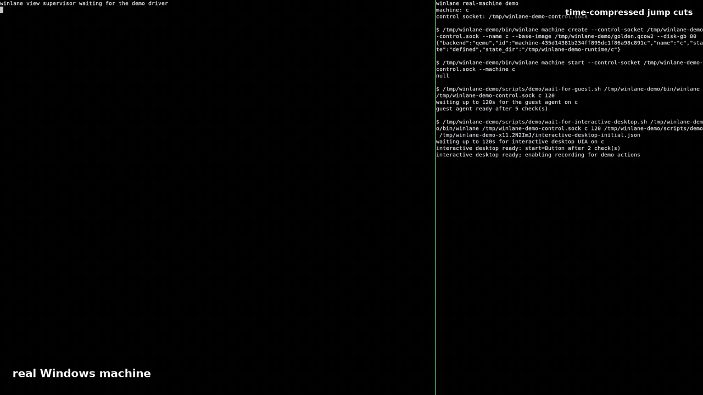

# winlane

Disposable Windows machines for coding agents, visible and controllable from a terminal.

winlane is local-first. It provisions Windows into a golden qcow2 image, boots copy-on-write machines under QEMU/KVM, exposes the display in a terminal, and gives agents two control planes: hardware input through QMP and semantic Windows UI Automation through the guest agent.



The first supported path is narrow on purpose: Linux x86_64, KVM, QEMU, Windows 11 x64, UEFI, swtpm, virtio drivers, isolated or QEMU user-mode NAT networking, and Kitty-protocol high-resolution terminal rendering with a clearly labeled half-block preview fallback.

## Why

Agents can already operate cloud browsers and Linux shells. Windows desktop software is different: installers, browsers, Electron apps, enterprise tools, and OS dialogs still assume a real machine. winlane makes that machine disposable and inspectable without sending the desktop to a hosted service.

The interesting part is not "Windows in a terminal" by itself. It is the combination of:

- unattended Windows provisioning with measured timings and readiness evidence
- independent machine clones that never mutate the golden image or source machine
- terminal rendering plus hardware keyboard, mouse, paste, scroll, and screenshot control
- UI Automation tree, invoke, and set-text operations running in the interactive Windows session
- process execution and explicit file import/export through QEMU Guest Agent
- a local MCP boundary for agent control
- an append-only evidence model for machine actions

## Current status

winlane is a working private alpha, not a finished release.

Validated on real Windows 11 Enterprise Evaluation guests:

- two fresh unattended installs completed end-to-end using the committed boot arrangement, about 14.5 minutes each
- an integrated daemon booted a copy-on-write overlay from a golden image
- the golden image hash stayed unchanged after boot and control operations
- QEMU Guest Agent readiness, process execution, and file import/export round trips passed
- frame capture returned a real 1024x768 Windows screen
- UI Automation returned real desktop and Notepad nodes from the interactive session
- invoking a visible Notepad control succeeded through the semantic UI path
- QEMU lifecycle and checkpoint behavior passed real QEMU/KVM tests on blank machines
- a running Windows checkpoint restored QEMU memory/device and disk state; the restored frame hash exactly matched the pre-change checkpoint-state frame
- a stopped Windows machine clone booted and exposed a ready guest agent
- independent clone validation passed on real Windows machines: the clone had no backing file, kept a pre-clone guest marker after source destruction, and never received a post-clone source marker
- isolated networking produced no QEMU user NAT, `netdev`, or virtio-net device; the guest had no non-loopback adapter, route, DNS, or outbound connectivity
- NAT networking produced a VirtIO adapter, DHCP address `10.0.2.15/24`, working DNS, host HTTP access, and a real `HTTP/1.1 200 OK` response from `example.com`
- pointer movement reached the Windows desktop and produced visible cursor/tooltip state
- MCP initialization and tool discovery exposed lifecycle, hardware, semantic, process, and file tools
- MCP machine create/start, UI tree read, process execution, file round trips, stop, checkpoint restore, and destroy passed against a live Windows machine
- MCP `ui_invoke` invoked a real Notepad `Got it` button and the control disappeared from the next UI tree
- MCP `ui_set_text` wrote `semantic proof` into the real Notepad document; independent ValuePattern and TextPattern reads matched exactly
- a stopped-machine checkpoint restore followed by start reached a responsive guest agent and returned a real 57-node UI tree
- paced keyboard input typed a 72-character lowercase alphanumeric Notepad string exactly
- MCP evidence sequences stayed contiguous, redacted sensitive process arguments and typed text, and content-addressed large output blobs
- two concurrent Windows machines reached guest-agent readiness, captured frames, survived daemon SIGTERM cleanup without recovery boots, restarted cleanly, and were destroyed with no QEMU, swtpm, daemon, or MCP processes left
- exact Kitty-protocol rendering was visually validated under Xvfb: official kitty 0.51.1 passed prior geometry/input validation, while WezTerm 20240203-110809-5046fc22 and Ghostty 1.1.3 matched the aspect-fit `RenderPlan` exactly through initial layout, font zoom, window resize, and split-pane phases, with exact terminal click inverse mapping
- release live-view capture pacing reached 5.00 captures/s in idle and visibly changing Windows sessions at the default `--fps 5`
- the committed demo harness completed a real 145.234-second Windows recording on the exact integrated build; initial capture started only after interactive desktop readiness, Notepad first-run popup dismissal was verified absent, post-restore ValuePattern text matched `before checkpoint` exactly, and evidence, cleanup, and golden-image integrity passed
- raw-view UI Automation exposed the legacy Run dialog field that the control view did not; raw-path set-text and correct-runtime-id invoke both succeeded on real Windows
- wrong-runtime-id semantic input failed before changing UI state; path-only input remained compatible
- the ASCII keyboard matrix matched in Notepad for uppercase, lowercase, digits, space, shifted punctuation, tab, and Enter after accounting for Windows line endings; `ctrl+a` replacement matched exactly and unsupported Unicode was rejected before typing

Not yet proven end-to-end:

- hardware keyboard input is limited to printable ASCII plus newline and tab, paced at roughly 25 characters per second
- checkpoint consistency while firmware or TPM state is actively changing
- terminal input behavior across real terminal emulators beyond the validated kitty, Ghostty, and WezTerm X11 paths
- live-view throughput above the validated 5 captures/s default
- long-running stability and broader concurrent machine use

Running checkpoints include RAM and can be several GiB. Clones collapse the backing chain into independent qcow2 images so the source can keep changing or be destroyed safely; cloning a large Windows disk can take real time and disk space. Clones receive fresh firmware-variable and TPM state rather than exact copies of those small states. Machines started before the checkpoint fix do not have the required disk node name and cannot use the new running-checkpoint restore path.

## Requirements

Host:

- Linux x86_64 with KVM access
- QEMU with `qemu-system-x86_64` and `qemu-img`
- OVMF UEFI firmware
- swtpm
- Rust stable, using the repository toolchain file
- kitty, Ghostty, or WezTerm for the validated Kitty-graphics high-resolution path, or any truecolor terminal for the half-block preview fallback; iTerm2, tmux, and sixel currently use conservative fallback behavior until independently validated

Guest media:

- a licensed or evaluation Windows 11 x64 ISO
- the Fedora virtio-win driver ISO

winlane does not download or redistribute Windows. Evaluation media has its own Microsoft license terms.

Before provisioning or starting a daemon, run the read-only host preflight:

```sh
cargo run --release -p winlane-cli -- doctor
```

`doctor` prints one JSON report with pass, warning, and hard-failure checks plus remediation text. It does not install packages or mutate the host. Warnings do not fail the command; missing hard requirements do. Use `--root PATH` to check free space for a non-default machine-root filesystem.

## Build

```sh
cargo build --release --workspace
```

## Provision a golden image

```sh
cargo run --release -p winlane-provision -- provision \
  --name win11-alpha \
  --iso /path/to/windows-11-enterprise-eval-x64-en-us.iso \
  --virtio-iso /path/to/virtio-win.iso \
  --artifact-root /path/to/winlane-state \
  --timeout-minutes 75 \
  --json
```

The output golden image is written under the artifact root as `win11-alpha/golden.qcow2`. Provisioning writes a machine-readable report next to it. ISOs, disks, screenshots, reports, and machine state are deliberately ignored by git.

## Start the control daemon

```sh
cargo run --release -p winlane-cli -- daemon \
  --root /path/to/winlane-runtime \
  --control-socket /tmp/winlane-control.sock
```

Keep that process running in its own terminal or service manager.

## Create and boot a disposable machine

```sh
machine=$(cargo run --release -p winlane-cli -- machine create \
  --control-socket /tmp/winlane-control.sock \
  --name demo-1 \
  --base-image /path/to/winlane-state/win11-alpha/golden.qcow2)

cargo run --release -p winlane-cli -- machine start \
  --control-socket /tmp/winlane-control.sock \
  --machine demo-1
```

`machine create` prints one JSON object. Machine lifecycle and view commands accept either `--machine-json "$machine"` or `--machine NAME`. Name resolution asks the control daemon to list machines and fails if the name is absent or ambiguous. Guest commands also accept either form. With `--machine NAME`, they require `--control-socket PATH` for one control-list lookup, then connect directly to the resolved `state_dir/qga.sock` exactly as before.

List machines known under the daemon root. The output is one compact JSON array:

```sh
cargo run --release -p winlane-cli -- machine list \
  --control-socket /tmp/winlane-control.sock
```

Clone a stopped machine or destroy it explicitly:

```sh
clone=$(cargo run --release -p winlane-cli -- machine clone \
  --control-socket /tmp/winlane-control.sock \
  --machine demo-1 \
  --name demo-1-copy)

cargo run --release -p winlane-cli -- machine destroy \
  --control-socket /tmp/winlane-control.sock \
  --machine demo-1-copy
```

Create a checkpoint and save the printed reference. A running-machine checkpoint includes QEMU memory/device state; a stopped-machine checkpoint includes disk state. Labels are optional and limited to ASCII letters, digits, dash, and underscore:

```sh
cargo run --release -p winlane-cli -- machine checkpoint create \
  --control-socket /tmp/winlane-control.sock \
  --machine demo-1 \
  --label before-risky-change \
  > /tmp/demo-1-checkpoint.json
```

List registered and orphaned checkpoint metadata for a machine. Output is a compact JSON array; corrupt or missing metadata is reported in-place and never deleted or repaired implicitly:

```sh
cargo run --release -p winlane-cli -- machine checkpoint list \
  --control-socket /tmp/winlane-control.sock \
  --machine demo-1
```

Entries contain `id`, `label`, `created_unix_ms`, `kind`, `state_dir_bytes`, `registered`, `restorable`, and `error`. `state_dir_bytes` counts only checkpoint artifacts stored outside the qcow2 image; QEMU-internal disk and memory snapshot size is not cheaply available. `restorable` is a cheap metadata, registry, and stopped-machine preflight, not a guarantee that restore cannot fail.

Delete one checkpoint by id while the machine is stopped. The daemon deletes the internal qcow2 snapshot first; the checkpoint directory and registry entry are removed only after that succeeds. This works for checkpoints created from either stopped or running machines:

```sh
cargo run --release -p winlane-cli -- machine checkpoint delete \
  --control-socket /tmp/winlane-control.sock \
  --machine demo-1 \
  --checkpoint-id CHECKPOINT_ID
```

The checkpoint file is an opaque, machine-local reference to checkpoint state already managed by the daemon; it is not a portable copy of the disk or memory contents. Restore can use that saved file or select a checkpoint by machine and id. The current backend requires the machine to be stopped before restore. Stopped-checkpoint disk state is applied during restore; running-checkpoint memory/device state is loaded when the machine starts again. Restore prints the machine handle:

```sh
cargo run --release -p winlane-cli -- machine stop \
  --control-socket /tmp/winlane-control.sock \
  --machine demo-1

cargo run --release -p winlane-cli -- machine checkpoint restore \
  --control-socket /tmp/winlane-control.sock \
  --machine demo-1 \
  --checkpoint-id CHECKPOINT_ID

cargo run --release -p winlane-cli -- machine checkpoint restore \
  --control-socket /tmp/winlane-control.sock \
  --checkpoint-file /tmp/demo-1-checkpoint.json

cargo run --release -p winlane-cli -- machine start \
  --control-socket /tmp/winlane-control.sock \
  --machine demo-1
```

## Watch and control the display

```sh
cargo run --release -p winlane-cli -- view \
  --control-socket /tmp/winlane-control.sock \
  --machine demo-1
```

Ctrl-Q detaches. Terminal paste normalizes line endings and rejects control bytes or invisible formatting characters before anything is typed into the guest. Unsupported Unicode text is rejected by the hardware keyboard path rather than being turned into incorrect key events.

kitty, Ghostty, and WezTerm receive PNG frames that winlane scales host-side with CatmullRom to the exact aspect-fit physical-pixel rectangle. Frames are transmitted at that exact pixel size without terminal `c`/`r` rescaling and positioned with cursor row/column plus `X`/`Y` subcell offsets, so visual geometry and input inverse mapping share the same `RenderPlan`. winlane uses real terminal pixel geometry from `TIOCGWINSZ` when available and the `--cell-width-px`/`--cell-height-px` values as fallback geometry. Fit-to-pane can still be physically small in a split pane. Use `--zoom PERCENT` (100-400) for a fixed center crop, then Ctrl+Arrow keys to pan the crop. The zoom is a viewport crop, not a claim that a tiny pane can show the whole desktop readably.

Outside Kitty-protocol terminals winlane uses half-blocks only as a preview fallback and reserves a terminal row labeled `HALF-BLOCK PREVIEW` when there is enough space. Kitty passthrough inside tmux is not enabled: released tmux (through 3.8) does not reliably manage Kitty placements per pane, and the pane-aware implementation exists only in unreleased tmux master/next-3.9 work. Manual APC passthrough cannot provide reliable pane clipping or redraw semantics, so tmux deliberately keeps the preview fallback.

Wait for the guest agent with a bounded timeout. The result is compact JSON; timeout prints `ready:false` and exits nonzero:

```sh
cargo run --release -p winlane-cli -- machine wait \
  --control-socket /tmp/winlane-control.sock \
  --machine demo-1 \
  --for guest-agent \
  --timeout-seconds 120
```

## Use the semantic guest plane

Run a process:

```sh
cargo run --release -p winlane-cli -- guest run \
  --machine demo-1 \
  --control-socket /tmp/winlane-control.sock \
  --command 'C:\Windows\System32\cmd.exe' \
  --arg /c \
  --arg 'echo winlane-guest'
```

Read the UI Automation tree:

```sh
cargo run --release -p winlane-cli -- guest ui-tree \
  --machine demo-1 \
  --control-socket /tmp/winlane-control.sock \
  --max-depth 8 \
  --max-nodes 2000
```

The tree output states its `view`. UI operations default to `--view control`; pass `--view raw` to `ui-tree` to use the raw UI Automation walker. When invoking or setting text on a node path, pass the same view used to read the tree that produced the path. Also pass that node's `runtimeId` as `--runtime-id` when available; invoke and set-text then fail if the resolved path now points at an element with a different or unavailable runtime id. Path-only calls remain accepted for compatibility but are not identity-checked. Runtime-id verification has been live-validated on raw-view invoke and set-text paths.

Invoke an element from the current tree:

```sh
cargo run --release -p winlane-cli -- guest invoke \
  --machine demo-1 \
  --control-socket /tmp/winlane-control.sock \
  --node 0/1/3
```

Node paths are snapshot-scoped. A path such as `0/1/3` can point somewhere else after windows open, close, or reorder. Generation checking is not reliable across separate guest connections, so use a fresh tree immediately before invoking and pass the runtime id when available.

Import and export files explicitly:

```sh
cargo run --release -p winlane-cli -- guest import \
  --machine demo-1 \
  --control-socket /tmp/winlane-control.sock \
  --host-path ./payload.txt \
  --guest-path 'C:\Windows\Temp\payload.txt'

cargo run --release -p winlane-cli -- guest export \
  --machine demo-1 \
  --control-socket /tmp/winlane-control.sock \
  --guest-path 'C:\Windows\Temp\payload.txt' \
  --host-path ./payload.out.txt
```

There is no shared clipboard and no host folder pass-through.

## MCP

Run the stdio MCP server against the control daemon:

```sh
cargo run --release -p winlane-cli -- mcp \
  --control-socket /tmp/winlane-control.sock \
  --evidence-dir /path/to/evidence
```

The hardware-plane MCP tools cover machine creation, listing, cloning, destruction, lifecycle, guest-agent readiness waits, screenshots, input, scrolling, and checkpoints. `machine_wait` accepts only `for: "guest-agent"`, polls conservatively, and returns `ready:false` with `error:"timeout"` when its bounded `timeout_seconds` expires. `machine_list` returns the same machine-handle array as the CLI list command. Inputs with a top-level `machine` field accept either a full machine handle or an exact machine-name string; names are resolved through the control daemon on each call. With `--evidence-dir`, those operations append JSONL evidence events. Typed text is stored as hash plus length, not raw text. If a tool operation succeeds but evidence recording fails, the MCP result stays successful and carries an explicit `evidence_error` field instead of misreporting the machine operation as failed.

Semantic guest MCP tools cover UI tree, invoke, set-text, process execution, and file transfer. Live validation covers real UI tree reads, invoke, set-text, process execution, file round trips, and restore-then-start. UI element paths are snapshot-scoped: read a fresh tree before invoking or writing a node. The semantic tools accept `view` as `control` (default) or `raw`; use the same view for the tree and for invoke/set-text paths derived from it. Pass `runtime_id` from the same fresh tree when available; without it, path-only invoke/set-text is not identity-checked. Raw-view and runtime-id verification have been live-validated on Windows.

Export or inspect evidence. Export writes `events.jsonl` plus the content-addressed `blobs/` directory:

```sh
cargo run --release -p winlane-cli -- evidence export \
  --evidence-dir /path/to/evidence \
  --output /path/to/evidence-export

cargo run --release -p winlane-cli -- evidence tail \
  --evidence-dir /path/to/evidence \
  --limit 20

cargo run --release -p winlane-cli -- evidence verify \
  --evidence-dir /path/to/evidence
```

`evidence verify` prints a compact JSON integrity report and exits nonzero after printing if verification fails. It validates event JSON shape, event kinds, and contiguous sequence numbers. It also recursively verifies string-valued payload fields named `blob`: each must be a well-formed lowercase SHA-256, exist under `blobs/`, and stream-hash to the same content digest. Hash-like values under other field names are not interpreted as blob references, and unreferenced files in `blobs/` are not errors.

## Stop the machine

```sh
cargo run --release -p winlane-cli -- machine stop \
  --control-socket /tmp/winlane-control.sock \
  --machine-json "$machine"
```

Stop the daemon through the control plane when finished:

```sh
cargo run --release -p winlane-cli -- daemon stop \
  --control-socket /tmp/winlane-control.sock
```

The stop response is delivered before the daemon exits. Once shutdown starts, new control requests are rejected; the daemon then stops recorded machines through the same cleanup path used for SIGINT/SIGTERM and removes the Unix control socket. SIGKILL can leave a stale socket file, which the next daemon startup replaces when no active listener is present.

## Architecture

```text
winlane-cli
  ├─ control daemon ── winlane-ipc ── winlane-core ── QEMU/QMP/swtpm
  ├─ terminal view ─── winlane-view ── kitty / half-block rendering
  ├─ guest control ── winlane-guest ── QEMU Guest Agent / UI Automation
  └─ MCP stdio ────── winlane-mcp ─── control IPC + evidence events

winlane-provision
  └─ unattend.xml + virtio + UEFI + TPM + qcow2 golden image
```

The security boundary is the VM. Host clipboard sharing, host folder sharing, and implicit networking are intentionally absent. Guest UI text is untrusted input; agents should treat it like any other content that may contain prompt injection.

## Repository layout

- `crates/winlane-contracts` — shared machine, control, frame, checkpoint, and evidence types
- `crates/winlane-core` — QEMU lifecycle, QMP, input, screenshots, clones, checkpoints
- `crates/winlane-provision` — unattended Windows installation and readiness probes
- `crates/winlane-view` — terminal capability detection, frame conversion, rendering, input mapping
- `crates/winlane-guest` — QEMU Guest Agent, interactive-session UI Automation, process/file control
- `crates/winlane-ipc` — serialized Unix-socket machine control boundary
- `crates/winlane-mcp` — MCP tool schemas and stdio server
- `crates/winlane-evidence` — append-only JSONL events and content-addressed blobs
- `crates/winlane-cli` — user-facing command wiring

## Development gates

```sh
cargo fmt --check
cargo test --workspace
cargo clippy --workspace --all-targets -- -D warnings
```

Windows integration claims must come from real runs. Do not document simulated provisioning, fake UIA trees, or fixture-only behavior as live validation.
